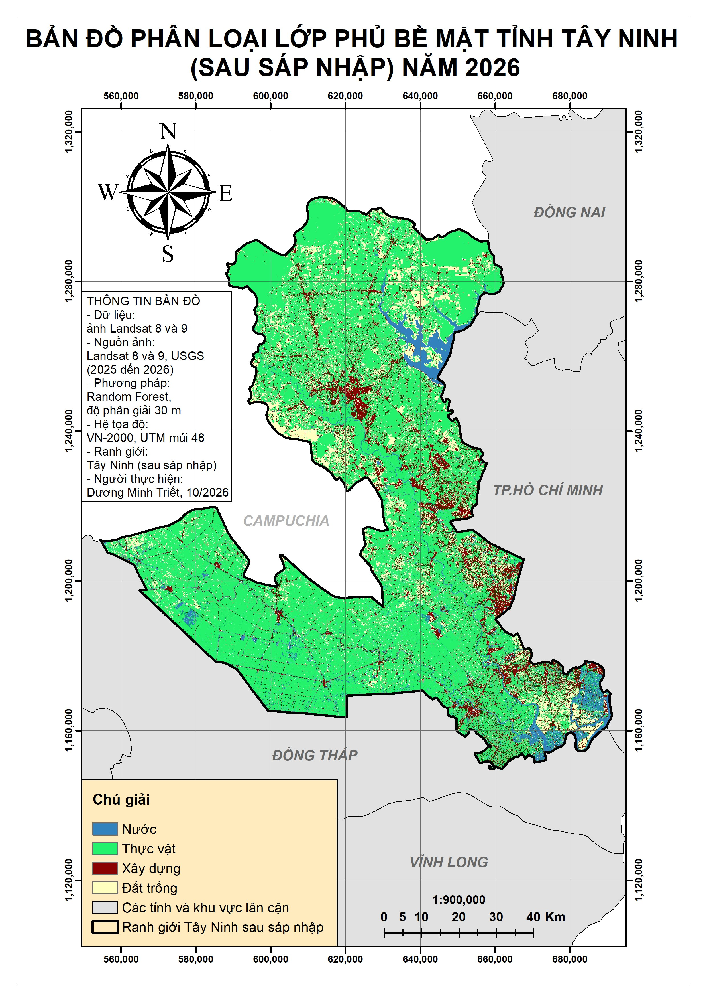

# Xây dựng mô hình phân loại lớp phủ bề mặt từ ảnh Landsat bằng Machine Learning

Đồ án chuyên ngành, Khoa Công nghệ Thông tin, Trường Đại học Tài nguyên và Môi trường TP.HCM.

- Sinh viên: Dương Minh Triết, MSSV 1250080211, lớp 12_ĐH_CNPM3
- Giảng viên hướng dẫn: ThS. Từ Thanh Trí

Đồ án phân loại lớp phủ bề mặt tỉnh Tây Ninh sau sáp nhập (hợp nhất Tây Ninh và Long An, khoảng 855.494 ha) thành bốn lớp Nước, Thực vật, Xây dựng, Đất trống từ ảnh Landsat 8 và 9 năm 2026, bằng Google Earth Engine (GEE) và bốn thuật toán Random Forest (RF), CART, SVM, Gradient Tree Boosting (GTB). Bản đồ cuối được biên tập trong ArcMap 10.8.

<p align="center">
  
</p>

*Bản đồ minh họa đã biên tập trong ArcMap, lấy từ kết quả chạy ngày 25/10/2026. Dữ liệu gốc là tệp GeoTIFF `data/output/TayNinh_LandCover_RF_MT_2026.tif` (mã lớp 0 Nước, 1 Thực vật, 2 Xây dựng, 3 Đất trống).*

## Kết quả chính

| Nội dung | Giá trị |
|---|---|
| Cấu hình chọn | RF, bộ đặc trưng đa thời gian (MT, 16 đặc trưng), không lọc majority |
| OA trên tập kiểm tra tách khối (406 điểm) | 74,9%, Kappa 0,655 |
| OA trung bình 5 lần chia khối (độ lệch chuẩn) | RF MT 75,7% (2,0); SVM MT 76,6% (1,7); GTB MT 75,1% (1,3) |
| OA hiệu chỉnh theo diện tích (340 điểm ngẫu nhiên phân tầng, chấm mù) | 70,8% (± 6,5), Kappa 0,41 |
| Diện tích hiệu chỉnh (ha) | Nước 47.028; Thực vật 571.854; Xây dựng 51.313; Đất trống 185.287 |

Kiểm định t cặp cho thấy chưa đủ bằng chứng thống kê để phân biệt RF, SVM, GTB (p = 0,087 và 0,368), còn bộ MT cao hơn bộ băng gốc và chỉ số có ý nghĩa (p = 0,004). Chi tiết trong báo cáo (Chương 3 và Phụ lục 3 đến 7).

## Cấu trúc thư mục

```
gee/       Mã nguồn GEE (JavaScript, chạy trong Code Editor)
python/    Mã Python tính độ chính xác, kiểm định thống kê, đối chiếu diện tích
data/
  input/   Dữ liệu đầu vào: nhãn do người gán, bảng đối chiếu điểm kiểm định, danh sách ảnh Landsat
  results/ Kết quả xuất từ GEE và kết quả đánh giá (CSV)
  output/  Bản đồ phân loại cuối (GeoTIFF, VN-2000 UTM 48N, 30 m)
docs/      Báo cáo (Word, PDF), báo cáo giải trình chỉnh sửa
```

## Môi trường

- GEE: tài khoản Google Earth Engine và một Cloud project. Mã chạy trong Code Editor (https://code.earthengine.google.com).
- Python 3.10 trở lên. Cài thư viện: `pip install -r requirements.txt`
- Bản đồ chuyên đề: ArcMap 10.8 (không bắt buộc để chạy lại số liệu).

## Dữ liệu và nguồn

- Ảnh: `LANDSAT/LC08/C02/T1_L2` và `LANDSAT/LC09/C02/T1_L2` trên GEE. Mùa khô 01/01/2026 đến 30/04/2026 (41 cảnh), chuỗi 12 tháng 01/11/2025 đến 21/10/2026. Danh sách cảnh: `data/input/DACN_DanhSachAnh_Landsat.csv`.
- Ranh giới: lớp địa phận tỉnh do giảng viên học phần Viễn thám cơ bản cung cấp, chọn hai đa giác Tây Ninh và Long An, hợp nhất bằng Dissolve trong ArcMap, tải lên GEE dạng Table asset. Tệp shapefile không kèm trong kho vì không có thông tin cấp phép; có thể gửi theo yêu cầu. Để chạy lại, tự tải lớp ranh giới tương tự lên GEE và sửa `ROI_ASSET`.
- Nhãn: điểm chọn tay (1.000 điểm, nằm trong script GEE) và điểm ngẫu nhiên phân tầng chấm mù (vòng 1: `data/input/ref_labeled_round1.csv`; vòng kiểm định cuối 340 điểm: `data/input/kq_vong2_nhan_do_nguoi_gan.txt` và `DACN_RefPoints_Key_FromAsset_vong2.csv`).

## Cách chạy

### 1. Phân loại và so sánh mô hình (GEE)

1. Tải ranh giới lên GEE Assets (Table), ví dụ `projects/<project>/assets/ranh_gioi_tay_ninh_moi`.
2. Mở `gee/dacn_landcover_v4.js` trong Code Editor, sửa `ROI_ASSET` thành đường dẫn của bạn.
3. Giữ `CHOSEN_MODEL = 'RF'`, `CHOSEN_SET = 'MT'`, `USE_SMOOTH = false` (cấu hình của báo cáo), bấm Run.
4. Ở tab Tasks, chạy các tác vụ xuất CSV (`DACN_ModelComparison`, `DACN_RepeatedSplits`, `DACN_FinalMetrics`, `DACN_TestPredictions`, `DACN_AreaByClass`) và ảnh GeoTIFF (`TayNinh_LandCover_v2`). Kết quả đã chạy sẵn nằm trong `data/results` và `data/output`.

GEE dùng bộ phân loại có hạt giống cố định (42), nên kết quả lặp lại được nếu bộ ảnh trong kho GEE không đổi. Số cảnh chuỗi 12 tháng khi chạy là 98; danh sách xuất lại ngày 16/11/2026 có 102 cảnh (xem Phụ lục 7 của báo cáo), nên chạy lại có thể lệch nhẹ các đặc trưng theo mùa.

### 2. Mẫu kiểm định và gán nhãn mù (GEE)

- `gee/dacn_reference_sampling.js`: lấy mẫu ngẫu nhiên phân tầng theo lớp bản đồ (dán vào cuối script chính, cần biến `FINAL_MAP`).
- `gee/dacn_labeling_tool.js`: công cụ gán nhãn mù, chỉ hiển thị mã điểm, tọa độ và ô vuông 30 m, không hiển thị lớp bản đồ.

### 3. Độ chính xác và diện tích hiệu chỉnh (Python)

```
python python/tinh_do_chinh_xac.py --labels data/input/kq_vong2_nhan_do_nguoi_gan.txt --key data/input/DACN_RefPoints_Key_FromAsset_vong2.csv --area data/results/DACN_AreaByClass.csv
```

Tái tạo Bảng 3.6 đến 3.8 của báo cáo (ma trận sai số, OA, Precision, Recall, F1, diện tích hiệu chỉnh theo phương pháp của Olofsson và cộng sự, 2014). Diện tích hiệu chỉnh của lớp j bằng tổng diện tích nhân với tổng p_ij theo cột j.

### 4. Kiểm định thống kê so sánh mô hình (Python)

```
python python/kiem_dinh_thong_ke.py --csv data/results/DACN_RepeatedSplits.csv
```

Tái tạo Bảng PL6: kiểm định t cặp trên OA của 5 lần chia khối.

### 5. Đối chiếu diện tích vùng nghiên cứu (Python và GEE)

```
python python/kiem_tra_dien_tich.py --shp <duong_dan>/ranh_gioi_tay_ninh_moi_dissolve.shp --tif data/output/TayNinh_LandCover_RF_MT_2026.tif
```

Giải thích khoản chênh 3.420,52 ha giữa diện tích đa giác trên GEE (858.912,63 ha, mặt cầu) và tổng diện tích các lớp (855.492,11 ha): 3.418,21 ha do mô hình mặt cầu so với ellipsoid, 2,31 ha do biên đa giác khác biên điểm ảnh. Script GEE `gee/dacn_danh_sach_anh_va_dien_tich.js` xuất danh sách ảnh và in các phép tính diện tích trên GEE.

## Mô tả các tệp dữ liệu

| Tệp | Nội dung |
|---|---|
| `data/results/DACN_ModelComparison.csv` | 16 cấu hình (4 thuật toán x 4 bộ đặc trưng): OA, Kappa, Precision, Recall, F1 từng lớp, lần chia chính (seed 42) |
| `data/results/DACN_RepeatedSplits.csv` | OA của 5 lần chia khối cho RF (4 bộ), SVM MT, GTB MT |
| `data/results/DACN_FinalMetrics.csv` | Chỉ số của cấu hình chọn (RF, MT) |
| `data/results/DACN_TestPredictions.csv` | Dự đoán trên 406 điểm kiểm tra |
| `data/results/DACN_AreaByClass.csv` | Diện tích đếm trên bản đồ (ha), lớp 0 Nước, 1 Thực vật, 2 Xây dựng, 3 Đất trống |
| `data/results/ketqua_vong1_olofsson.csv`, `ketqua_vong2_olofsson.csv` | Kết quả hiệu chỉnh của bản đồ vòng 1 và bản đồ cuối |
| `data/input/DACN_RefPoints_Key_FromAsset_vong2.csv` | Bảng đối chiếu điểm kiểm định (id, lớp bản đồ mc, kinh độ, vĩ độ) |
| `data/input/kq_vong2_nhan_do_nguoi_gan.txt` | Nhãn tham chiếu do người gán, dạng `id:nhãn`, nhãn 0 đến 3 |
| `data/input/ref_labeled_round1.csv` | 449 điểm ngẫu nhiên vòng 1 đã gán nhãn (dùng khi huấn luyện) |
| `data/input/nhan_lan2.txt` | Nhãn lần 2 của 100 điểm (chọn ngẫu nhiên phân tầng, seed 2026) |
| `data/results/DACN_PerPointPredictions.csv`, `DACN_ThuNghiemDacTrung.csv`, `DACN_RefDynamics.csv` | Dự đoán từng điểm của 4 mô hình trên 6 lần chia; thử nghiệm đặc trưng; biến động NDVI tại điểm tham chiếu |
| `data/input/DACN_DanhSachAnh_Landsat.csv` | Danh sách cảnh Landsat (mùa khô và chuỗi 12 tháng) |
| `data/output/TayNinh_LandCover_RF_MT_2026.tif` | Bản đồ cuối: 1 Nước, 2 Thực vật, 3 Xây dựng, 4 Đất trống, 255 không có dữ liệu (do mây), 0 ngoài ranh giới |

## Phần bổ sung sau phản hồi của giảng viên hướng dẫn

Các script dưới đây phục vụ kiểm định bổ sung (McNemar, CART lặp 5 lần chia, thử nghiệm đặc trưng cho Xây dựng và Đất trống, ảnh hưởng ngày tham chiếu, độ đồng ý giữa hai lần gán nhãn). Cách chạy xem `HUONG_DAN_BO_SUNG.md`.

| Tệp | Nội dung |
|---|---|
| `gee/dacn_bo_sung_v5.js` | Xuất dự đoán từng điểm của 4 mô hình, thử nghiệm đặc trưng, đặc trưng động tại điểm tham chiếu |
| `gee/dacn_labeling_tool_lan2.js` | Công cụ gán nhãn lần 2 cho 100 điểm chọn ngẫu nhiên phân tầng |
| `python/kiem_dinh_mcnemar.py` | McNemar chính xác, bootstrap theo khối, t ghép cặp và Friedman có CART |
| `python/so_sanh_thu_nghiem.py` | So sánh các bộ đặc trưng thử nghiệm |
| `python/danh_gia_ngay_tham_chieu.py` | Độ bất đồng nhãn theo mức biến động NDVI trong mùa khô |
| `python/kappa_nguoi_gan_nhan.py` | Chọn 100 điểm và tính Cohen kappa |

### Kết quả kiểm định bổ sung (chạy ngày 16/11/2026)

Toàn bộ đầu ra nằm ở `data/results/ketqua_kiem_dinh_bo_sung.txt`. Tóm tắt:

- CART lặp 5 lần chia: OA trung bình 65,9%, thấp hơn RF 9,8 điểm (p Holm = 0,004). McNemar trên 406 điểm: RF so với SVM p Holm = 1,00, RF so với GTB p Holm = 0,62. Friedman cho RF, SVM, GTB: p = 0,24.
- Thử nghiệm đặc trưng (RF, 5 lần chia): bộ MT cộng 6 đặc trưng mới nâng F1 Xây dựng từ 0,73 lên 0,76 và F1 Đất trống từ 0,75 lên 0,78 trên tập kiểm tra tách khối. Chưa dùng cho bản đồ cuối vì phải chọn và gán nhãn lại mẫu kiểm định.
- Ngày tham chiếu: điểm biến động NDVI mạnh trong mùa khô không bất đồng nhãn nhiều hơn điểm ổn định (Spearman 0,05 đến 0,06).
- Gán lại 100 điểm (cùng một người gán): Kappa 0,86. Không phải thẩm định độc lập.
- Lưu ý: chạy lại ngày 16/11/2026, RF bộ MT lần chia chính cho OA 75,6% thay vì 74,9% ở lần chạy gốc ngày 25/10/2026 (chạy lại script v4 cũng cho 75,6%); nhiều khả năng do kho ảnh GEE cập nhật. Bản đồ cuối và số liệu kiểm định ở Chương 3 là kết quả lần chạy gốc.

## Hạn chế đã biết

Nhãn do một người gán bằng ảnh vệ tinh, chưa điều tra thực địa và chưa thẩm định độc lập; lớp Xây dựng và Đất trống có chất lượng thấp (F1 lần lượt 0,59 và 0,32); chưa đủ bằng chứng thống kê để phân biệt RF, SVM, GTB; nguồn gốc lớp ranh giới chưa kiểm chứng được. Phạm vi sử dụng bản đồ nêu ở Phụ lục 6 của báo cáo.
